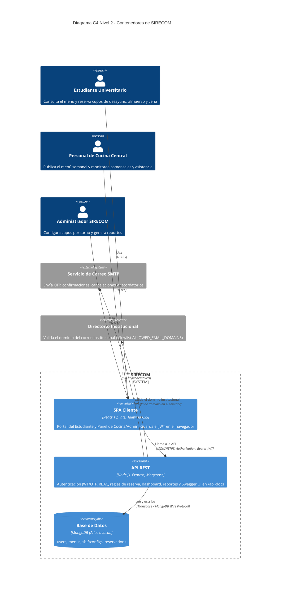
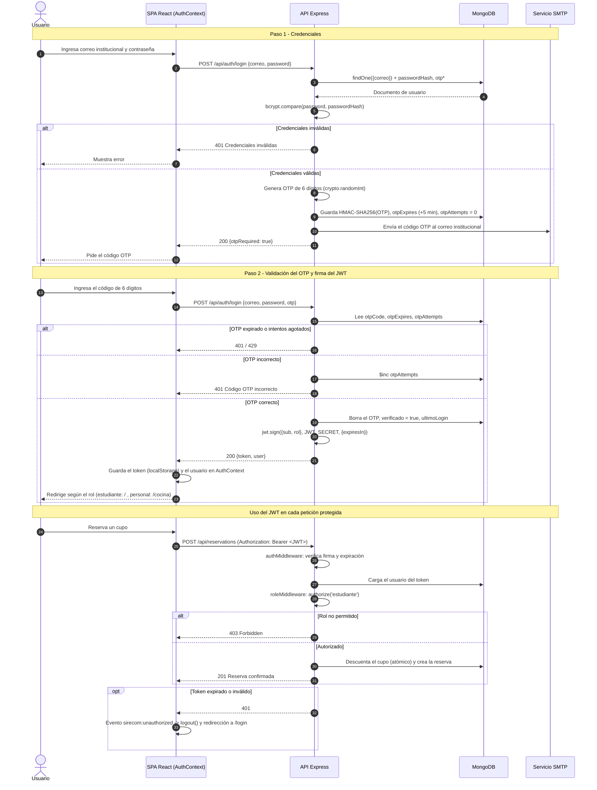
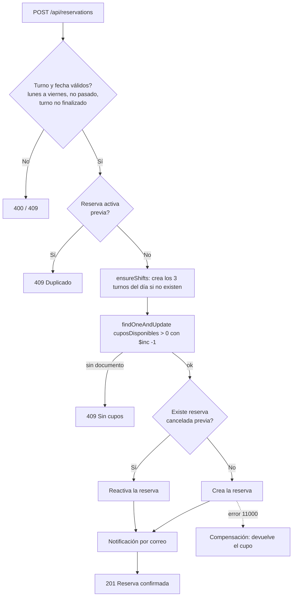
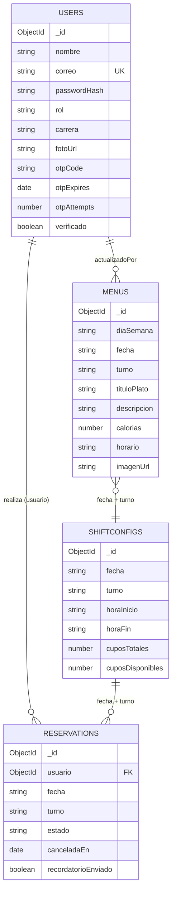

<div align="center">

# UNIVERSIDAD ADVENTISTA DE BOLIVIA
## FACULTAD DE INGENIERÍA DE SISTEMAS

**ASIGNATURA: TECNOLOGÍAS EN INTERNET**

# PROYECTO: "SIRECOM - SISTEMA DE RESERVAS DE COMEDORES UNIVERSITARIOS"

*Segunda presentación: Producto Implementado y Repositorio GitHub*

</div>

| | |
|---|---|
| **Presentan** | Est. Leonardo Radek Condori Yucra<br>Est. Seyla Esther Coimbra Mita<br>Est. Jose Diego Rivas Ayala<br>Est. Esmeralda Alegre Mamani |
| **Docente** | Ing. Victor Hugo Sarzuri Flores |
| **Fecha** | 10/11/2026 |
| **Asignatura** | Tecnologías en Internet |

> ## 🔗 REPOSITORIO PÚBLICO DE GITHUB
> ### **https://github.com/`<USUARIO>`/`<REPOSITORIO>`**
> *(Reemplazar por el enlace real antes de entregar. Requisito excluyente: el repositorio debe ser público.)*

---

## Índice

1. Carátula e Información General
2. Resumen Ejecutivo y Alcance
3. Trazabilidad de Requisitos
4. Arquitectura del Sistema
5. Diseño de Persistencia en MongoDB
6. Especificación de Endpoints y API REST
7. Configuración de Entorno y Variables
8. Manual de Ejecución y Pruebas
9. Conclusiones y Trabajo Futuro

---

## 1. Carátula e Información General

| Campo | Detalle |
|---|---|
| Proyecto | SIRECOM - Sistema de Reservas de Comedores Universitarios |
| Entrega | Segunda Entrega del Proyecto Integrador: Producto Implementado y Repositorio GitHub |
| Asignatura | Tecnologías en Internet |
| Facultad / Universidad | Facultad de Ingeniería de Sistemas - Universidad Adventista de Bolivia |
| Docente | Ing. Victor Hugo Sarzuri Flores |
| Integrantes | Leonardo Radek Condori Yucra, Seyla Esther Coimbra Mita, Jose Diego Rivas Ayala, Esmeralda Alegre Mamani |
| Fecha de entrega | 10/11/2026 |
| Repositorio público | **https://github.com/`<USUARIO>`/`<REPOSITORIO>`** |
| Documentación interactiva | `http://localhost:5000/api-docs` (Swagger UI, OpenAPI 3.0) |
| Prototipo de la 1ra entrega | https://www.figma.com/proto/5cBrywIrX6fu1jul4wpON9?node-id=0-1&t=Dq8FYjTOTrEbSu0k-6 |

---

## 2. Resumen Ejecutivo y Alcance

### 2.1 Resumen ejecutivo

SIRECOM es una aplicación web fullstack que digitaliza la reserva de cupos en los comedores universitarios (desayuno, almuerzo y cena). Resuelve los tres problemas identificados en la Primera Entrega: (1) sobreproducción o escasez de alimentos por falta de proyección de demanda, (2) aglomeraciones en los turnos pico, en especial el almuerzo, y (3) ausencia de un canal formal para confirmar asistencia.

La Segunda Entrega materializa el prototipo de Figma en un sistema funcional con arquitectura cliente-servidor desacoplada:

- Una **SPA en React** (Vite + Tailwind CSS) con dos experiencias: **Portal del Estudiante** (Navbar superior en desktop, Bottom Tab Bar en móvil de 375 px) y **Panel de Cocina Central / Administración** (Sidebar lateral en desktop, menú tipo drawer en móvil).
- Una **API REST** en Node.js + Express, protegida con **JWT** y **RBAC**, documentada con **Swagger / OpenAPI 3.0**.
- Persistencia **NoSQL en MongoDB** mediante **Mongoose**, con validaciones estrictas e índices de rendimiento.

### 2.2 Alcance alcanzado en esta entrega

| Área | Alcance implementado |
|---|---|
| Autenticación | Registro con correo institucional y login en dos pasos (contraseña + OTP de 6 dígitos) que entrega un JWT. Bloqueo por intentos fallidos de OTP y límite de tasa por IP. |
| Autorización | RBAC en middleware backend para `estudiante`, `cocina_central` y `admin`, y rutas protegidas por rol en el frontend. |
| Estudiante | Almuerzo del día, 3 tarjetas de turno con cupos en tiempo casi real (actualización cada 30 s), reserva, cancelación, reservas activas, historial paginado y perfil con fotografía. |
| Cocina Central | Dashboard con 3 KPIs, gráfico de reservas semanales y cronograma; editor de menú semanal; registro de asistencia; reportes exportables (XLSX, PDF, CSV). |
| Administrador | Configuración de cupos máximos por turno y por día (o por semana completa). |
| Notificaciones | Correo de confirmación, cancelación y recordatorio (~1 h antes del turno). Sin SMTP, se imprimen en consola. |
| Documentación | Swagger UI interactivo con esquemas, códigos HTTP y seguridad Bearer. |

**Fuera de alcance (declarado):** integración real con el SSO institucional (se simula con una lista blanca de dominios de correo), pasarela de pagos y aplicación nativa.

### 2.3 Tecnologías integradas

| Capa | Tecnologías |
|---|---|
| Frontend | React 18, Vite 5, Tailwind CSS 3, React Router 6, Axios |
| Backend | Node.js ≥ 18, Express 4, Mongoose 8, jsonwebtoken, bcryptjs, Helmet, CORS, express-rate-limit, Morgan |
| Base de datos | MongoDB (local o Atlas) |
| Documentación | swagger-jsdoc, swagger-ui-express (OpenAPI 3.0.3) |
| Correo y reportes | Nodemailer, ExcelJS, PDFKit |

---

## 3. Trazabilidad de Requisitos

### 3.1 Matriz de trazabilidad completa (RF → Frontend → Backend)

| Código | Descripción del requisito | Componente Frontend (React) | Endpoint / Servicio Backend |
|---|---|---|---|
| **RF-001** | Registro de usuarios con correo institucional y validación por OTP | `<Register />`, `AuthContext.register` | `POST /api/auth/register` (valida dominio, hash Bcrypt, genera y envía OTP) |
| **RF-002** | Inicio de sesión mediante OTP enviado al correo institucional | `<Login />` (pasos credenciales y OTP), `AuthContext.login`, `<ProtectedRoute />` | `POST /api/auth/login` (paso 1 envía OTP; paso 2 valida OTP y firma el JWT), `GET /api/auth/me` |
| **RF-003** | Dashboard con métricas clave en tiempo real | `<KitchenDashboard />`, `<KpiCard />` (actualización cada 30 s) | `GET /api/dashboard/metrics` |
| **RF-004** | Registro y edición del menú semanal por turno (Cocina Central) | `<WeeklyMenuEditor />` | `GET /api/menus`, `POST /api/menus`, `PUT /api/menus/:id` |
| **RF-005** | Menú del día con horario y valor calórico | `<StudentHome />` (tarjeta "Almuerzo de hoy") | `GET /api/menus?fecha=&turno=` |
| **RF-006** | Reservar un cupo en un turno con cupos disponibles | `<StudentHome />`, `<ShiftCard />` | `POST /api/reservations` |
| **RF-007** | Actualizar cupos en tiempo real al reservar o cancelar | `<ShiftCard />`, `<ProgressBar />` (normal azul / crítica roja < 10 %) | `GET /api/shifts` + descuento atómico (`findOneAndUpdate` con `$inc`) |
| **RF-008** | Cancelar reserva activa antes del inicio del turno | `<MyReservations />` (diálogo de confirmación) | `PATCH /api/reservations/:id/cancel` |
| **RF-009** | Historial de reservas con estado de asistencia | `<ReservationHistory />` (filtro y paginación) | `GET /api/reservations/my-history` |
| **RF-010** | Alertas por correo: confirmación, cancelación, recordatorio | Notificaciones `Toast` en la UI | `utils/mailer.js`, disparado por `POST /api/reservations`, `PATCH .../cancel` y `jobs/reminders.js` |
| **RF-011** | Reportes de asistencia y reservas exportables (PDF / Excel) | `<ReportsView />` | `GET /api/reports/export?formato=xlsx\|pdf\|csv\|json` |
| **RF-012** | Configurar cupos máximos por turno y por día | `<ShiftConfigPanel />` (solo admin) | `PUT /api/shifts/config` |
| **RF-013** | Ver y editar perfil (nombre, carrera, fotografía) | `<UserProfile />`, `AuthContext` | `GET /api/auth/me`, `PUT /api/users/profile` |
| **RF-014** | Interfaz responsive en escritorio y móvil | `<StudentLayout />` (Navbar + Bottom Tab Bar), `<StaffLayout />` (Sidebar + drawer), breakpoints de Tailwind | N/A (transversal al frontend) |

Complementos que soportan los casos de uso de la Primera Entrega: `GET /api/reservations` y `PATCH /api/reservations/:id/attendance` (caso de uso "Gestionar reservas activas" y fuente de la tasa de asistencia) con `<ActiveReservations />`.

### 3.2 Justificación técnica de cumplimiento de Requisitos No Funcionales

| RNF | Requisito | Cómo se cumple | Alcance / evidencia |
|---|---|---|---|
| **RNF-001** | Rendimiento: API < 200 ms (meta reforzada de la 2da entrega: **< 150 ms**) y carga < 2 s | Índices compuestos en todas las consultas calientes (ver sección 5); `.lean()` en lecturas; agregaciones con `$match` sobre campos indexados; contadores de cupos precalculados en `ShiftConfig` (no se recuentan reservas); descuento de cupo en una sola operación atómica. El servidor devuelve la cabecera `X-Response-Time` en cada respuesta para medirlo. Frontend: bundle de producción con Vite de ~284 kB (≈ 91 kB gzip) y CSS de ~22 kB. | Medible con `X-Response-Time`, Swagger (`displayRequestDuration`) y Network de DevTools. Los tiempos dependen del hardware y de la latencia a MongoDB; no se presentan cifras medidas en este informe. |
| **RNF-002** | Seguridad: JWT/OAuth2, HTTPS en tránsito, AES-256 en reposo | **Implementado en código:** Bcryptjs (salt ≥ 10, forzado por `Math.max(10, …)`), JWT firmado con `JWT_SECRET` y expiración configurable, RBAC en middleware, OTP almacenado como HMAC-SHA256 (nunca en claro) con vigencia e intentos máximos, `rate-limit` en autenticación, Helmet, CORS restringido, mensajes genéricos en credenciales inválidas y comparación de tiempo constante. **Delegado al despliegue:** HTTPS (proxy inverso / plataforma) y cifrado en reposo AES-256 (MongoDB Atlas lo ofrece). | HTTPS y AES-256 no se configuran en el código de la aplicación; se cumplen al desplegar en infraestructura que los provea. JWT se usa en lugar de OAuth2 completo. |
| **RNF-003** | Usabilidad / Accesibilidad: WCAG 2.1 AA | Contrastes calculados con la fórmula WCAG para los pares principales: azul `#1B2A4A` sobre blanco **14.2:1**; azul sobre dorado `#E8A93C` (botones) **6.9:1**; muted `#5B6472` sobre blanco **6.0:1**; rojo `#C0392B` sobre blanco **5.4:1**. El verde `#1E8E5A` rinde 4.1:1 sobre blanco, por debajo de 4.5:1, por lo que para **texto** se usa la variante `success-dark #17724A` (**5.9:1**). Además: etiquetas `label` asociadas a cada campo, `role="progressbar"` con `aria-valuetext`, `aria-live` en avisos, foco visible, navegación por teclado, `prefers-reduced-motion`, textos alternativos en imágenes y tablas con `caption` y `scope`. | Cumplimiento verificado a nivel de contraste y semántica; no se ejecutó una auditoría completa con lector de pantalla. |
| **RNF-004** | Compatibilidad: navegadores modernos, 375 px a 1440 px | Diseño mobile-first con breakpoints de Tailwind (`md`, `lg`); Bottom Tab Bar (< 768 px) y Navbar / Sidebar (≥ 768 px); tablas con scroll horizontal controlado. CSS autoprefixed (Autoprefixer). | Verificación manual recomendada en Chrome, Firefox, Safari y Edge. |
| **RNF-005** | Disponibilidad 99.5 % y backups diarios | Cierre ordenado del servidor (SIGINT / SIGTERM), conexión con tiempo de espera de selección de servidor, manejo centralizado de errores y endpoint `GET /api/health` para monitoreo. **Delegado al despliegue:** SLA de disponibilidad y backups automáticos diarios (Atlas). | Requisito de infraestructura; el código aporta salud y apagado seguro. |
| **RNF-006** | Escalabilidad: 500 solicitudes concurrentes en el almuerzo | API sin estado (JWT, sin sesiones en memoria) que permite escalar horizontalmente; `maxPoolSize: 20` en MongoDB; reserva sin condiciones de carrera gracias a `findOneAndUpdate({cuposDisponibles: {$gt: 0}}, {$inc: {cuposDisponibles: -1}})` y al índice único `{usuario, fecha, turno}`; recordatorios con marca atómica para evitar duplicados con varias instancias. | No se ejecutó una prueba de carga; se recomienda k6 o Artillery como trabajo futuro. |

#### Validaciones adicionales de la Segunda Entrega

| Validación solicitada | Implementación |
|---|---|
| Backend < 150 ms con consultas indexadas | Índices en `users`, `menus`, `shiftconfigs`, `reservations` (sección 5) |
| Frontend rápido con Vite + Tailwind, 100 % responsive | `vite build` y purga de CSS de Tailwind; layouts adaptativos |
| Bcrypt salt ≥ 10; JWT firmado con expiración configurable | `config/index.js` (`bcryptRounds`, `jwtExpiresIn`) |
| Accesibilidad básica y manejo claro de errores de red | `getErrorMessage()` distingue error del servidor, tiempo de espera y falta de conexión; `<Alert onRetry>` ofrece reintentar |

---

## 4. Arquitectura del Sistema

### 4.1 Diagrama C4 Nivel 2 (Contenedores)



> **Nota de coherencia con la implementación:** el "Directorio Institucional (SSO)" de la Primera Entrega se implementa en esta etapa como una **validación de dominio** en el servidor (`ALLOWED_EMAIL_DOMAINS`), no como una integración real con un SSO. Queda como trabajo futuro (sección 9).

### 4.2 Diagrama de secuencia de Autenticación y Autorización (JWT + OTP)



### 4.3 Flujo de reserva (consistencia de cupos)



La compensación evita perder cupos si la inserción falla después del descuento atómico.

### 4.4 Estructura de capas del backend

| Capa | Archivos | Responsabilidad |
|---|---|---|
| Entrada | `server.js`, `app.js` | Arranque, conexión a BD, middlewares globales, Swagger |
| Rutas | `routes/*.js` | Verbo + ruta + cadena `auth → authorize → controller` |
| Middlewares | `authMiddleware.js`, `roleMiddleware.js`, `errorHandler.js` | JWT, RBAC, errores uniformes |
| Controladores | `controllers/*.js` | Reglas de negocio |
| Modelos | `models/*.js` | Esquemas, validadores e índices |
| Utilidades | `utils/*.js`, `jobs/reminders.js` | Fechas en zona horaria local, OTP, correo, recordatorios |

---

## 5. Diseño de Persistencia en MongoDB

### 5.1 Modelo conceptual



**Relaciones:** `reservations.usuario` referencia a `users._id` (relación **referenciada**, 1 a N). `menus` y `shiftconfigs` se relacionan **por clave natural** `(fecha, turno)` y no por ObjectId, lo que evita *joins* y mantiene los documentos autónomos. Las fechas se guardan como texto `YYYY-MM-DD` (día calendario local, zona `America/La_Paz`), lo que elimina errores de zona horaria y mantiene los índices simples.

### 5.2 Colección `users`

| Campo | Tipo | Validaciones |
|---|---|---|
| `nombre` | String | Obligatorio, trim, 3 a 100 caracteres |
| `correo` | String | Obligatorio, **único**, minúsculas, formato de correo y **dominio institucional** (validador contra `ALLOWED_EMAIL_DOMAINS`) |
| `passwordHash` | String | Obligatorio, `select: false` (Bcrypt, salt ≥ 10) |
| `rol` | String | Enum `estudiante`, `cocina_central`, `admin`; por defecto `estudiante` |
| `carrera` | String | Máximo 120 caracteres |
| `fotoUrl` | String | Vacío, URL http(s) o imagen PNG/JPEG/WEBP en base64; máximo 400 000 caracteres |
| `otpCode`, `otpExpires`, `otpAttempts` | String, Date, Number | `select: false`; el código se guarda como HMAC-SHA256 |
| `verificado`, `ultimoLogin` | Boolean, Date | Control de cuenta |

**Índices:** `{correo: 1}` único (login y registro); `{rol: 1}`.

### 5.3 Colección `menus`

| Campo | Tipo | Validaciones |
|---|---|---|
| `diaSemana` | String | Enum Lunes a Viernes; se **deriva automáticamente** de `fecha` |
| `fecha` | String | Obligatorio, regex `YYYY-MM-DD` y fecha calendario válida |
| `turno` | String | Enum `desayuno`, `almuerzo`, `cena` |
| `tituloPlato` | String | Obligatorio, máximo 150 |
| `descripcion` | String | Obligatorio, máximo 600 (sopa, acompañamientos, postre, refresco) |
| `calorias` | Number | Obligatorio, 0 a 3000 |
| `horario` | String | Por defecto el del turno (p. ej. `12:00h - 14:00h`) |
| `imagenUrl`, `actualizadoPor` | String, ObjectId | URL http(s); referencia a `users` |

**Índice:** `{fecha: 1, turno: 1}` **único** (un menú por fecha y turno; cubre consultas por día y por semana).

### 5.4 Colección `shiftconfigs`

| Campo | Tipo | Validaciones |
|---|---|---|
| `fecha`, `turno` | String | Igual que arriba |
| `horaInicio`, `horaFin` | String | Formato `HH:MM` (07:00-09:00, 12:00-14:00, 18:00-20:00) |
| `cuposTotales` | Number | Entero 0 a 5000 (por defecto 300 / 500 / 400) |
| `cuposDisponibles` | Number | Entero ≥ 0 y **≤ cuposTotales** (validador) |

**Índice:** `{fecha: 1, turno: 1}` **único**. Los documentos se crean de forma perezosa (`ensureShifts`) con *upsert* idempotente.

### 5.5 Colección `reservations`

| Campo | Tipo | Validaciones |
|---|---|---|
| `usuario` | ObjectId → `User` | Obligatorio |
| `fecha`, `turno` | String | Igual que arriba |
| `estado` | String | Enum `activa`, `cancelada`, `asistio`, `ausente`; por defecto `activa` |
| `canceladaEn`, `recordatorioEnviado`, `marcadaPor` | Date, Boolean, ObjectId | Auditoría y control de recordatorios |

**Índices:**

| Índice | Propósito |
|---|---|
| `{usuario: 1, fecha: 1, turno: 1}` **único** | Impide reservas duplicadas (requisito) |
| `{fecha: 1, turno: 1, estado: 1}` | Dashboard, listados del personal y reportes |
| `{usuario: 1, fecha: -1}` | Historial del estudiante ordenado por fecha |

> **Decisión de diseño:** como el índice único incluye la clave `(usuario, fecha, turno)` aunque la reserva esté cancelada, al **volver a reservar** el mismo turno se **reactiva** el documento cancelado en lugar de insertar uno nuevo.

### 5.6 Garantías de consistencia

1. **Descuento atómico de cupo** en una sola operación (`$inc` condicionado a `cuposDisponibles > 0`), sin leer y luego escribir.
2. **Devolución con tope:** al cancelar, `cuposDisponibles = min(disponibles + 1, cuposTotales)` mediante *pipeline update*.
3. **Cambio de capacidad seguro:** `PUT /api/shifts/config` recalcula `disponibles = nuevoTotal − reservados` con *pipeline update* y rechaza (409) un total menor al ya reservado.
4. **Cancelación idempotente:** el cambio de estado se condiciona a `estado: 'activa'`, evitando devolver el cupo dos veces.

---

## 6. Especificación de Endpoints y API REST

**Base URL local:** `http://localhost:5000` · **Formato:** JSON · **Autenticación:** `Authorization: Bearer <JWT>` salvo los endpoints públicos.

### 6.1 Matriz de endpoints

| Método | Ruta | Parámetros / Body | Códigos HTTP | Rol RBAC | Descripción |
|---|---|---|---|---|---|
| GET | `/api/health` | - | 200 | Público | Estado del servicio |
| POST | `/api/auth/register` | Body: `nombre`, `correo`, `password`, `carrera?` | 201, 400, 409, 429 | Público | Crea la cuenta (rol `estudiante`) y envía OTP |
| POST | `/api/auth/login` | Body: `correo`, `password`, `otp?` | 200, 400, 401, 429 | Público | Paso 1: envía OTP. Paso 2 (con `otp`): devuelve JWT |
| GET | `/api/auth/me` | - | 200, 401 | Autenticado | Usuario de la sesión activa |
| PUT | `/api/users/profile` | Body: `nombre?`, `carrera?`, `fotoUrl?` | 200, 400, 401 | Autenticado | Edita el perfil |
| GET | `/api/menus` | Query: `fecha?`, `semana?`, `turno?` | 200, 400, 401 | Autenticado | Menú del día o de la semana (por defecto, semana actual) |
| POST | `/api/menus` | Body: `fecha`, `turno`, `tituloPlato`, `descripcion`, `calorias`, `horario?`, `imagenUrl?` | 201, 400, 401, 403, 409 | `cocina_central`, `admin` | Crea el menú de un día y turno |
| PUT | `/api/menus/:id` | Path: `id`. Body: campos editables | 200, 400, 401, 403, 404, 409 | `cocina_central`, `admin` | Edita un menú (no permite fechas pasadas) |
| GET | `/api/shifts` | Query: `fecha?` | 200, 400, 401 | Autenticado | Cupos por turno y reserva propia del día |
| PUT | `/api/shifts/config` | Body: `turno`, `cuposTotales`, `fecha?`, `aplicarSemana?` | 200, 400, 401, 403, 409 | `admin` | Capacidad máxima por turno y día (o semana) |
| POST | `/api/reservations` | Body: `turno`, `fecha?` | 201, 400, 401, 403, 409 | `estudiante` | Reserva un cupo (atómico) y notifica |
| GET | `/api/reservations/my-history` | Query: `estado?`, `desde?`, `hasta?`, `orden?`, `page?`, `limit?` | 200, 400, 401, 403 | `estudiante` | Historial paginado (`estado=activa` para vigentes) |
| GET | `/api/reservations` | Query: `fecha?`, `turno?`, `estado?` | 200, 400, 401, 403 | `cocina_central`, `admin` | Reservas de un día con datos del estudiante |
| PATCH | `/api/reservations/:id/cancel` | Path: `id` | 200, 400, 401, 403, 404, 409 | `estudiante` (dueño), `admin` | Cancela antes del turno y devuelve el cupo |
| PATCH | `/api/reservations/:id/attendance` | Body: `estado` (`asistio` \| `ausente`) | 200, 400, 401, 403, 404, 409 | `cocina_central`, `admin` | Registra asistencia |
| GET | `/api/dashboard/metrics` | Query: `fecha?`, `turno?` (`almuerzo` por defecto o `todos`) | 200, 400, 401, 403 | `cocina_central`, `admin` | KPIs, reservas semanales y cronograma |
| GET | `/api/reports/export` | Query: `desde?`, `hasta?`, `formato?` (`json`, `csv`, `xlsx`, `pdf`) | 200, 400, 401, 403 | `cocina_central`, `admin` | Reporte de asistencia y reservas |

Los códigos **409 (conflicto de negocio)** y **429 (límite de intentos)** se suman a los 200, 201, 400, 401, 403 y 404 requeridos. Todos los errores comparten la forma `{ status, message, details? }`.

### 6.2 Métricas del dashboard (definiciones)

| KPI | Cálculo |
|---|---|
| Cupos reservados | `Σ (cuposTotales − cuposDisponibles)` del turno seleccionado en la fecha |
| Comensales proyectados | `round(cuposReservados × (1 + PROJECTION_WALKIN_FACTOR))`; el factor (0.19 por defecto) estima comensales sin reserva |
| Tasa de asistencia | `asistio / (asistio + ausente)` en los últimos 14 días; la variación compara contra los 14 días previos |
| Variación de proyectados | Respecto al mismo día de la semana anterior |

### 6.3 Integración con Swagger UI

- **Interfaz interactiva:** `GET /api-docs` (también redirige desde `/`). **JSON OpenAPI:** `GET /api-docs.json`.
- Generada con `swagger-jsdoc` a partir de `config/swagger.js` (OpenAPI **3.0.3**): 15 rutas, 8 esquemas reutilizables, esquema de seguridad `bearerAuth` (HTTP Bearer JWT) y respuestas 200/201/400/401/403/404/409/429 documentadas con ejemplos.
- **Cómo probar con Swagger:** (1) `POST /api/auth/login` con correo y contraseña; (2) copiar el OTP de la consola del servidor; (3) repetir con `otp` y copiar el `token`; (4) botón **Authorize** y pegar el token; (5) ejecutar cualquier endpoint protegido. La autorización persiste (`persistAuthorization`).
- **Captura sugerida para el informe final:** pantalla de `/api-docs` con las etiquetas Auth, Menús, Turnos, Reservas, Dashboard y Reportes desplegadas.

---

## 7. Configuración de Entorno y Variables

Existen tres archivos de referencia **sin credenciales reales**: `.env.example` (raíz), `server/.env.example` y `client/.env.example`. Se copian a `.env` (ignorado por Git).

### 7.1 Backend (`server/.env`)

| Variable | Descripción | Desarrollo | Producción |
|---|---|---|---|
| `NODE_ENV` | Entorno de ejecución | `development` | `production` (oculta detalles de errores 5xx) |
| `PORT` | Puerto del servidor | `5000` | El asignado por la plataforma |
| `MONGODB_URI` | Cadena de conexión | `mongodb://127.0.0.1:27017/sirecom` | `mongodb+srv://...` (Atlas) con usuario de mínimo privilegio |
| `JWT_SECRET` | Secreto de firma del JWT y del HMAC del OTP. **Obligatorio**, mínimo 16 caracteres (recomendado 32+) | Cualquier valor largo | Aleatorio de 48 bytes, guardado en el gestor de secretos |
| `JWT_EXPIRES_IN` | Vigencia del token | `1d` | `1h` a `1d` según la política |
| `BCRYPT_SALT_ROUNDS` | Costo de Bcrypt (mínimo forzado: 10) | `10` | `10` a `12` |
| `CLIENT_URL` | Orígenes CORS permitidos (separados por coma) | `http://localhost:5173` | Dominio real del frontend |
| `ALLOWED_EMAIL_DOMAINS` | Dominios de correo institucional permitidos | `uab.edu.bo` | Dominio(s) oficiales |
| `APP_TIMEZONE` | Zona horaria para "hoy" y horarios de turnos | `America/La_Paz` | `America/La_Paz` |
| `OTP_TTL_MINUTES` | Vigencia del OTP | `5` | `5` |
| `OTP_MAX_ATTEMPTS` | Intentos de OTP antes de exigir uno nuevo | `5` | `3` a `5` |
| `SMTP_HOST`, `SMTP_PORT`, `SMTP_SECURE`, `SMTP_USER`, `SMTP_PASS`, `SMTP_FROM` | Servidor de correo. Si `SMTP_HOST` está vacío, los correos (con el OTP) se imprimen en consola | Vacío (modo consola) | Proveedor SMTP real |
| `ENABLE_REMINDERS` | Activa los recordatorios automáticos | `true` | `true` |
| `PROJECTION_WALKIN_FACTOR` | Factor de comensales sin reserva para la proyección | `0.19` | Calibrar con datos reales |
| `MAX_ADVANCE_DAYS` | Días máximos de anticipación para reservar | `7` | `7` |

### 7.2 Frontend (`client/.env`)

| Variable | Descripción | Desarrollo | Producción |
|---|---|---|---|
| `VITE_API_URL` | URL base de la API | `http://localhost:5000/api` | `https://api.tu-dominio.com/api` |

Solo las variables con prefijo `VITE_` se exponen al navegador; **nunca** se colocan secretos en el frontend. Vite incrusta el valor en tiempo de *build*, por lo que hay que reconstruir al cambiarlo.

### 7.3 Buenas prácticas aplicadas
- `.gitignore` excluye `node_modules/`, `.env`, `dist/`, `build/` y archivos de sistema, con excepción explícita de `!.env.example`.
- El servidor **no arranca** sin `JWT_SECRET` válido (falla rápido con un mensaje claro).
- En producción: HTTPS obligatorio, rotación periódica del secreto y lista de IP de Atlas restringida.

---

## 8. Manual de Ejecución y Pruebas

### 8.1 Requisitos previos
Node.js ≥ 18, npm, MongoDB local o cuenta de MongoDB Atlas, y Git.

### 8.2 Instalación y ejecución

```bash
# 1. Clonar
git clone https://github.com/<USUARIO>/<REPOSITORIO>.git
cd <REPOSITORIO>

# 2. Backend
cd server
npm install
cp .env.example .env          # editar MONGODB_URI y JWT_SECRET
npm run seed                  # datos de demostración
npm run dev                   # http://localhost:5000  (Swagger en /api-docs)

# 3. Frontend (en otra terminal)
cd client
npm install
cp .env.example .env
npm run dev                   # http://localhost:5173
```

### 8.3 Datos de demostración (`npm run seed`)
Contraseña de todas las cuentas: `Sirecom#2026`.

| Rol | Correo |
|---|---|
| Estudiante | `carlos.mendoza@uab.edu.bo` |
| Cocina Central | `cocina@uab.edu.bo` |
| Administrador | `admin@uab.edu.bo` |

El *seed* crea 7 usuarios, menús y cupos de la semana actual y siguiente, y un historial de 150 reservas con tasa de asistencia del 84 %. Los cupos de **hoy** se inicializan como en el prototipo (desayuno 110/300, almuerzo 42/500, cena 215/400), lo que permite ver el estado **crítico** (barra roja, < 10 %) del almuerzo. Los KPIs del dashboard se **calculan** con los datos reales, por lo que no coincidirán exactamente con las cifras ilustrativas de Figma (342 / 287 / 84 %).

### 8.4 Casos de prueba de los flujos críticos

#### CU-02 Iniciar sesión con validación OTP
| # | Paso | Resultado esperado |
|---|---|---|
| 1 | Abrir `http://localhost:5173/login` | Formulario de acceso |
| 2 | Ingresar `carlos.mendoza@uab.edu.bo` y la contraseña | Pantalla de código OTP; en la consola del servidor aparece `[MAIL:DEV] ... código ######` |
| 3 | Ingresar el OTP | Redirección al portal del estudiante (`/`) |
| 4 | (Alternativo 3a) Intentar con `alguien@gmail.com` | Error: solo correos institucionales |
| 5 | (Alternativo 5a) Ingresar un OTP incorrecto | Error y, tras 5 intentos, exige reenviar el código |
| 6 | Entrar como `cocina@uab.edu.bo` | Redirección automática a `/cocina` |

#### CU-01 Reservar cupo de comedor
| # | Paso | Resultado esperado |
|---|---|---|
| 1 | En *Inicio*, ver las 3 tarjetas de turno | Contadores `disponibles / totales`; almuerzo en rojo si < 10 % |
| 2 | Pulsar **Reservar Cupo** en Desayuno | Aviso de confirmación; el contador baja en 1; el botón cambia a "Reserva confirmada"; el correo (en consola) |
| 3 | (Alternativo 4a) Intentar reservar el mismo turno de nuevo | El botón ya está deshabilitado; por API responde 409 de duplicado |
| 4 | (Alternativo 3a) Reservar hasta agotar un turno (o fijar un cupo bajo en Configuración) | Botón deshabilitado "Sin cupos disponibles" |
| 5 | Ir a *Reservas* y cancelar | El cupo vuelve al contador; el turno aparece como Cancelada en *Historial* |

#### CU-03 Editar menú semanal (Cocina Central)
| # | Paso | Resultado esperado |
|---|---|---|
| 1 | Entrar como `cocina@uab.edu.bo` y pulsar **Editar Menú de Hoy** | Editor abierto con el menú del almuerzo de hoy |
| 2 | Vaciar el título y guardar | Mensaje de campos obligatorios (alternativo 4a) |
| 3 | Cambiar el título y guardar | Confirmación; el cronograma se actualiza |
| 4 | Entrar como estudiante y abrir *Inicio* | El "Almuerzo de hoy" muestra el nuevo título |

#### Pruebas de seguridad y API (Swagger o curl)
| Prueba | Esperado |
|---|---|
| `GET /api/shifts` sin token | 401 |
| `PUT /api/shifts/config` con token de estudiante | 403 |
| `POST /api/reservations` con token de cocina | 403 |
| Token manipulado o vencido | 401 y cierre de sesión automático en la SPA |
| Dos reservas simultáneas con 1 cupo restante | Una responde 201 y la otra 409 |
| `GET /api/reports/export?formato=xlsx` como cocina | Descarga del archivo Excel |

### 8.5 Verificación realizada al preparar esta entrega
- Backend: instalación de dependencias, comprobación de sintaxis de todos los archivos, carga de la aplicación y de la especificación Swagger, y respuestas esperadas en `/api/health` (200), `/api-docs` (200), rutas protegidas sin token (401) y ruta inexistente (404).
- Frontend: `vite build` de producción sin errores.
- **No se ejecutó** el flujo completo contra una instancia de MongoDB ni pruebas de carga en el entorno de generación; los casos de la sección 8.4 deben ejecutarse localmente con `npm run seed`.

---

## 9. Conclusiones y Trabajo Futuro

### 9.1 Conclusiones técnicas

1. **Del prototipo a la arquitectura:** los tokens de Figma (`#1B2A4A`, `#E8A93C`, `#F5F6F8`, `#1E8E5A`, `#C0392B`, `#5B6472`) se tradujeron literalmente a `tailwind.config.js`, y los componentes con variantes (botón, KPI Card, barra de progreso normal/crítica, tarjeta de turno, sidebar y tab bar) a componentes React reutilizables. El diseño responsive de 1440 px y 375 px se mantuvo mediante layouts diferenciados por rol.
2. **La consistencia de cupos es el núcleo técnico:** resolver la reserva con una operación atómica (`$inc` condicionado) y un índice único compuesto evita el sobrecupo y los duplicados sin bloqueos, lo que sustenta RNF-006.
3. **Seguridad por capas:** hash Bcrypt, OTP con HMAC y caducidad, JWT firmado, RBAC en el backend (la restricción en el frontend es solo de experiencia de usuario), limitación de tasa y cabeceras de seguridad.
4. **Documentación viva:** Swagger UI evita que la documentación se desfase y sirve como herramienta de prueba para la evaluación.
5. **Decisiones conscientes de alcance:** el SSO institucional se simuló con una validación de dominio; HTTPS, AES-256 en reposo y backups diarios se delegan al despliegue (Atlas y proxy inverso).

### 9.2 Lecciones aprendidas
- Modelar fechas como texto `YYYY-MM-DD` en la zona horaria del negocio eliminó una fuente típica de errores (cambios de día por UTC).
- Contrastar la paleta del prototipo con WCAG permitió detectar que el verde de marca no alcanza 4.5:1 como texto y resolverlo con una variante oscura sin alterar la identidad.
- Un índice único también condiciona el flujo funcional (reactivar la reserva cancelada), por lo que conviene diseñar índices y casos de uso a la vez.
- Los datos de demostración deterministas (84 % de asistencia exacto, cupos de hoy como en Figma) facilitan la defensa y las pruebas.

### 9.3 Trabajo futuro

| Prioridad | Mejora |
|---|---|
| Alta | Integración real con el SSO / directorio institucional (OAuth2 / OIDC) |
| Alta | Pruebas automatizadas: unitarias y de integración (Jest + Supertest + `mongodb-memory-server`) y E2E (Playwright) |
| Alta | Prueba de carga con k6 o Artillery para validar 500 solicitudes concurrentes y la meta de < 150 ms |
| Media | Despliegue con HTTPS, CI/CD (GitHub Actions) y monitoreo; backups automáticos en Atlas |
| Media | Tiempo real con WebSockets o SSE en lugar de sondeo cada 30 s |
| Media | Token en cookie `HttpOnly` + `SameSite` (hoy el JWT se guarda en `localStorage`, expuesto ante XSS) y refresh tokens |
| Media | Código QR de acceso al comedor y validación en puerta |
| Baja | Modo oscuro (las variables de diseño ya lo permiten), internacionalización y aplicación móvil (PWA) |
| Baja | Cargar la fotografía de perfil y las imágenes de menús a almacenamiento de objetos |

---

*Fin del informe técnico - SIRECOM, Segunda Entrega.*
